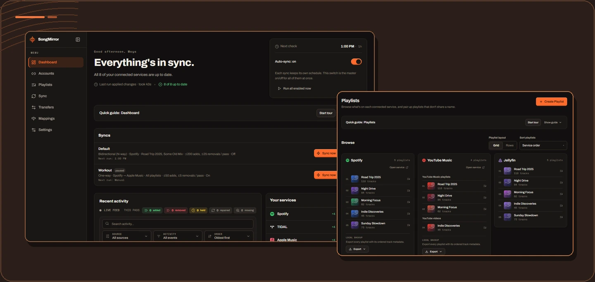

<div align="center"><a name="readme-top"></a>


# SongMirror

**আপনার প্লেলিস্ট সিঙ্ক রাখুন।**<br>
নিজের সার্ভারে নির্ধারিত সময়ে সিঙ্ক করুন, একবারের জন্য প্লেলিস্ট কপি করুন অথবা Jellyfin-এর জন্য সংগীতের স্থানীয় কপি রাখুন। বিনামূল্যে ও ওপেন সোর্স।

[![Docker দিয়ে চালান][docker-start-badge]](#quick-start)
[![GHCR][registry-badge]][registry-link]
[![Ko-fi-এ সহায়তা করুন][kofi-badge]][kofi-link]

[নির্দেশিত ইনস্টলেশন](#guided-install) · [সমর্থিত পরিষেবা](#supported-services) · [বৈশিষ্ট্য](#features) · [স্ক্রিনশট](guide.bn.md#screenshots) · [SongMirror-কে সহায়তা করুন](#support) · [ওয়েবসাইট][website-link]

<!-- LANGUAGE NAVIGATION -->
<p align="center"><a href="../../README.md" lang="en">English</a> · <a href="README.ar.md" lang="ar" dir="rtl">العربية</a> · <a href="README.tr.md" lang="tr">Türkçe</a> · <a href="README.es.md" lang="es">Español</a> · <a href="README.zh.md" lang="zh">简体中文</a> · <a href="README.fr.md" lang="fr">Français</a> · <a href="README.pt.md" lang="pt">Português</a> · <a href="README.de.md" lang="de">Deutsch</a> · <a href="README.ja.md" lang="ja">日本語</a> · <a href="README.hi.md" lang="hi">हिन्दी</a> · <a href="README.bn.md" lang="bn">বাংলা</a> · <a href="README.id.md" lang="id">Bahasa Indonesia</a> · <a href="README.ko.md" lang="ko">한국어</a> · <a href="README.it.md" lang="it">Italiano</a> · <a href="README.vi.md" lang="vi">Tiếng Việt</a></p>
<!-- /LANGUAGE NAVIGATION -->

<a href="guide.bn.md#screenshots"></a>

[![CI][ci-shield]][ci-link]
[![MIT][license-shield]](../../LICENSE)
[![GitHub-এ স্টার দিন][stars-shield]][stars-link]

</div>

<a id="quick-start"></a>

## 🚀 দ্রুত শুরু

```bash
git clone https://github.com/ahnafnafee/songmirror.git
cd songmirror
mkdir -p data downloads
docker compose up -d
```

**http://localhost:8888** খুলুন। **অ্যাকাউন্ট** থেকে আপনার পরিষেবাগুলো যুক্ত করুন। একবার কপি করতে **স্থানান্তর**, বা সময়সূচি অনুযায়ী তালিকা আপডেট করতে **সিঙ্ক** বেছে নিন।

<a id="guided-install"></a>

### নির্দেশিত ইনস্টলেশন

[Render](https://render.com/) · [CapRover](https://caprover.com/) · [Portainer](https://www.portainer.io/) · [ব্যবহার নির্দেশিকা](guide.bn.md#guided-install)

<a id="app-language"></a>

### অ্যাপের ভাষা

**সেটিংস → সাধারণ → ভাষা** থেকে ভাষা বদলান। ব্রাউজারের ভাষা অনুসরণ করতে **স্বয়ংক্রিয় (ব্রাউজার)** বেছে নিন।

<a id="supported-services"></a>

## সমর্থিত পরিষেবা

**অ্যাকাউন্ট → অ্যাকাউন্ট যোগ করুন** খুলে একটি পরিষেবা খুঁজুন।

| পরিষেবা | সিঙ্ক ও স্থানান্তরের সুবিধা |
| --- | --- |
| [Spotify](https://open.spotify.com/), [TIDAL](https://tidal.com/), [Qobuz](https://play.qobuz.com/), [Deezer](https://www.deezer.com/), [Amazon Music](https://music.amazon.com/), [Apple Music](https://music.apple.com/), [YouTube Music](https://music.youtube.com/), [Navidrome](https://www.navidrome.org/), [Subsonic](https://www.subsonic.org/) | প্লেলিস্ট ও পছন্দের গান |
| [SoundCloud](https://soundcloud.com/), [Anghami](https://play.anghami.com/), [Audiomack](https://audiomack.com/), [Gaana](https://gaana.com/), [JioSaavn](https://www.jiosaavn.com/) | প্লেলিস্ট |
| [Jellyfin](https://jellyfin.org/), [Emby](https://emby.media/), [Plex](https://www.plex.tv/media-server-downloads/), [Mopidy](https://mopidy.com/), [Lyrion Music Server](https://lyrion.org/) | সার্ভারের প্লেলিস্ট |
| [Last.fm](https://www.last.fm/) | পছন্দের গান, সবচেয়ে বেশি শোনা গান ও শোনার ইতিহাস। পছন্দের গান বদলাতে অনুমোদন দিন। |
| [ListenBrainz](https://listenbrainz.org/) | প্লেলিস্ট ও পছন্দের রেকর্ডিং। পরিবর্তন করতে ব্যবহারকারীর টোকেন লাগে। |
| [QQ Music](https://y.qq.com/), [LINE MUSIC](https://music.line.me/), [Pandora](https://www.pandora.com/), [Naver Vibe](https://vibe.naver.com/), [NetEase Cloud Music](https://music.163.com/) | উৎস হিসেবে পাবলিক প্লেলিস্টের লিঙ্ক বা সাইন ইন করা অ্যাকাউন্টের লাইব্রেরি ব্যবহার করুন। |

[প্রতিটি পরিষেবা সংযুক্ত করা](guide.bn.md#connecting-each-service) · [প্লেলিস্ট অ্যাডাপ্টারের নির্দেশিকা](../music-service-adapters.md)

<a id="features"></a>

## ✨ বৈশিষ্ট্য

- [একমুখী, দ্বিমুখী ও একাধিক উৎস থেকে সিঙ্ক](guide.bn.md#how-it-works)
- [একবারের জন্য প্লেলিস্ট স্থানান্তর](guide.bn.md#features) · [ইতিহাস ও পুনরুদ্ধার](../transfer-history.md)
- [প্লেলিস্ট মেটাডেটা ব্যাকআপ](guide.bn.md#playlist-metadata-backups) · [সংরক্ষিত অ্যালবাম স্থানান্তর](../saved-albums.md) · [স্থানীয় ডাউনলোড মিরর (Jellyfin)](guide.bn.md#local-download-mirror-jellyfin)

[ব্যবহার নির্দেশিকা](guide.bn.md)

<a id="support"></a>

## SongMirror-কে সহায়তা করুন

আপনার সহায়তা বিভিন্ন সংগীত পরিষেবায় রক্ষণাবেক্ষণ ও পরীক্ষার খরচ মেটাতে কাজে লাগে।

[![Ko-fi-এ সহায়তা করুন][kofi-badge]][kofi-link]
[![GitHub-এ স্পনসর করুন][sponsor-badge]][sponsor-link]

[GitHub-এ স্টার দিন][stars-link] · [উপরে ফিরুন](#readme-top)

<!-- LINK GROUP -->

[docker-start-badge]: https://img.shields.io/badge/Docker-CE4512?logo=docker&logoColor=white&style=for-the-badge
[registry-badge]: https://img.shields.io/badge/GHCR-27221F?logo=github&logoColor=white&style=for-the-badge
[registry-link]: https://github.com/ahnafnafee/songmirror/pkgs/container/songmirror
[kofi-badge]: https://img.shields.io/badge/Ko--fi-8F3B25?logo=ko-fi&logoColor=white&style=for-the-badge
[kofi-link]: https://ko-fi.com/ahnafnafee
[sponsor-badge]: https://img.shields.io/badge/GitHub_Sponsors-27221F?logo=githubsponsors&logoColor=white&style=for-the-badge
[sponsor-link]: https://github.com/sponsors/ahnafnafee
[ci-shield]: https://img.shields.io/github/actions/workflow/status/ahnafnafee/songmirror/ci.yml?branch=main&label=CI&style=flat-square
[ci-link]: https://github.com/ahnafnafee/songmirror/actions/workflows/ci.yml
[license-shield]: https://img.shields.io/badge/license-MIT-CE4512?style=flat-square
[stars-shield]: https://img.shields.io/github/stars/ahnafnafee/songmirror?style=flat-square
[stars-link]: https://github.com/ahnafnafee/songmirror/stargazers
[website-link]: https://songmirror.ahnafnafee.dev/
